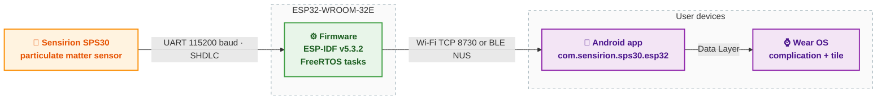

# SPS30 air-quality monitor on ESP32-WROOM-32E

The pioneer microcontroller port of the SPS30 particulate matter monitor: a Sensirion SPS30 sensor driven by an ESP32-WROOM-32E, with a companion Android phone and tablet app and a Wear OS complication plus tile.
This is the first firmware iteration in a lineage that started on a Raspberry Pi reference build and later moved to the ESP32-S3.

> **Status: finished and frozen.**
> This repository is a sealed reference build of the ESP32-WROOM-32E variant, archived at `pioneer-esp32-sps30-final-2026-08-26`.
> No further development targets this board; later iterations ship on the Olimex ESP32-S3-DevKit-Lipo.
> See the companion repositories under `mlfisch3`.

## System architecture



## Hardware

The SPS30 is driven over UART at 115200 baud using Sensirion's SHDLC framing.
The ESP32-WROOM-32E is wired as follows; the sensor's 5-pin JST ZH connector carries the signals (SEL left floating for UART).

### SPS30 pinout

| Pin | Name | UART function |
|----:|------|---------------|
| 1 | VDD | +5 V supply |
| 2 | RX  | Serial data into the sensor (host TX) |
| 3 | TX  | Serial data out of the sensor (host RX) |
| 4 | SEL | Interface select; floating = UART |
| 5 | GND | Ground |

### Wiring to the ESP32

Full wiring, including the level-shifter rationale between 5 V sensor logic and 3.3 V ESP32 pins, is in `docs/HARDWARE_SETUP.md`.

## Software components

| Component | Path | What it does |
|---|---|---|
| Firmware | `firmware/` | ESP-IDF v5.3.2 project. FreeRTOS tasks for acquisition, storage ring, Wi-Fi TCP server, and BLE Nordic UART Service. |
| Android app | `app/` | Android Studio Gradle project with Compose UI. Phone module plus a shared `core` KMP module and a Wear OS module. `applicationId com.sensirion.sps30.esp32`. |
| Specifications | `specs/` | Authoritative Python specs for `sps30`, `wire`, `power`, and `store`. The firmware's host-C test pack generates its vectors from these. |
| Design docs | `docs/` | PRD, architecture, hardware setup, BLE transport design, storage format, backup-and-clear procedure, feature design notes. |
| Tests | `tests/` | Python unit tests exercising the specs, plus the test vector set under `tests/vectors/`. |
| Tools | `tools/` | Host-side utilities for transfer, probing, log analysis, and heap tracing. |

## Repository layout

```
app/        Android Studio Gradle project (phone + Wear OS + core KMP)
docs/       PRD, architecture, hardware setup, BLE design, storage format, etc.
firmware/   ESP-IDF v5.3.2 project
specs/      Authoritative Python specifications
tests/      Python test pack, vectors, pytest configuration
tools/      Host-side utilities
```

## Quickstart

### Firmware

```bash
. ~/esp/esp-idf/export.sh
cd firmware && idf.py build
idf.py -p /dev/ttyUSB0 flash monitor
```

### Android app

Open `app/` in Android Studio, build the debug variant, install on the phone.
The app auto-discovers the ESP32 on the local network.

### Tests

```bash
cd tests && ./run_tests.sh
```

## Lineage

This ESP32-WROOM-32E build is the second iteration in a lineage of four hardware configurations under the same product line:

1. SPS30 on Raspberry Pi 4 - the reference build, frozen 2026-08-02.
2. **SPS30 on ESP32-WROOM-32E** - this repository, frozen 2026-08-26.
3. SPS30 on Olimex ESP32-S3-DevKit-Lipo - the second microcontroller iteration.
4. SEN66 on Olimex ESP32-S3-DevKit-Lipo - the current product, with gas and humidity channels.

Each iteration carries its own distinct `applicationId` so the Android apps coexist side by side on a single device.

## License

License to be added.
